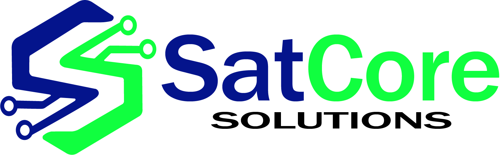

 <div align="center">



# SatCore Solutions

**Sitio web oficial de SOFTWARE AND TECHNOLOGY CORE SOLUTIONS**

_Soluciones digitales seguras, accesibles y funcionales para todos._

Plataforma web oficial de SatCore Solutions, desarrollada con tecnologías modernas para establecer la presencia digital de la organización, presentar su ecosistema tecnológico y proporcionar una base escalable para la evolución de sus servicios y soluciones digitales.

---

### SOFTWARE AND TECHNOLOGY CORE SOLUTIONS

**SATCORE SOLUTIONS**

[](https://github.com/satcoresolutions)

[](./LICENSE)

[](https://nextjs.org/)

[](https://react.dev/)

[](https://www.typescriptlang.org/)

[](https://tailwindcss.com/)

[](https://nodejs.org/)

[](https://www.npmjs.com/)

</div>

---

# Sobre el proyecto

**SatCore Solutions** es el sitio web oficial de **SOFTWARE AND TECHNOLOGY CORE SOLUTIONS**, una iniciativa tecnológica orientada al desarrollo de soluciones digitales, software, automatización, inteligencia artificial, ciberseguridad, formación tecnológica y herramientas digitales.

Este proyecto constituye la base tecnológica de la presencia digital oficial de SatCore Solutions. Su propósito es ofrecer una plataforma web moderna, organizada, escalable y mantenible que permita presentar la identidad de la organización, comunicar sus áreas de trabajo y facilitar la incorporación progresiva de nuevas funcionalidades.

La aplicación está construida sobre el framework Next.js, utilizando React para la interfaz de usuario, TypeScript para el desarrollo tipado y Tailwind CSS v4 para el sistema de estilos.

El proyecto incorpora una arquitectura de componentes reutilizables, una estructura centralizada para la identidad visual, variables CSS para la configuración de marca y una base de metadatos preparada para favorecer la correcta presentación del sitio en buscadores y plataformas sociales.

La estructura inicial fue generada mediante **SatCore Forge**, el sistema interno de generación y estructuración de proyectos de SatCore Solutions.

Este repositorio forma parte del ecosistema tecnológico de la organización. Su uso, distribución y modificación deben ajustarse a la licencia aplicable y a las condiciones establecidas por el titular del proyecto.

---

# Identidad corporativa

## SatCore Solutions

**Nombre comercial:** SatCore Solutions

**Nombre corporativo:** SOFTWARE AND TECHNOLOGY CORE SOLUTIONS

**Eslogan:**

> _Soluciones digitales seguras, accesibles y funcionales para todos._

SatCore Solutions desarrolla y organiza soluciones tecnológicas orientadas a la creación de software, la automatización de procesos, la seguridad informática, la educación tecnológica y la comunicación digital.

El ecosistema corporativo se estructura alrededor de cinco áreas principales.

### Desarrollo

Creación de sitios web, aplicaciones, plataformas digitales, herramientas de software y soluciones tecnológicas adaptadas a diferentes necesidades.

### Automatizador

Automatización de procesos, integración de APIs, agentes inteligentes y sistemas diseñados para ejecutar tareas de forma automatizada.

### Seguridad

Ciberseguridad, auditoría, análisis de vulnerabilidades, fortalecimiento de sistemas, monitoreo y protección de entornos tecnológicos.

### Estudio

Formación tecnológica, documentación, recursos educativos, tutoriales y proyectos orientados al aprendizaje y la experimentación.

### Marketing

Identidad de marca, presencia digital, creación de contenido tecnológico, analítica y herramientas para la comunicación y el posicionamiento.

Estas áreas representan la organización conceptual del ecosistema de SatCore Solutions. Su alcance funcional dentro del sitio web dependerá de las secciones y funcionalidades efectivamente implementadas.

---

# Características

El sitio web oficial de SatCore Solutions se apoya en una base tecnológica diseñada para facilitar su mantenimiento y evolución.

- **Framework moderno:** utiliza Next.js 15 con App Router para organizar la aplicación y sus rutas.
- **Interfaz basada en componentes:** emplea React 19 para construir interfaces reutilizables.
- **Desarrollo tipado:** utiliza TypeScript 5 para mejorar la consistencia y el mantenimiento del código.
- **Sistema de estilos moderno:** integra Tailwind CSS v4 con PostCSS.
- **Identidad visual centralizada:** incorpora una arquitectura de variables CSS y tokens de marca.
- **Sistema de temas:** organiza las variables visuales para mantener la coherencia de la interfaz.
- **Arquitectura escalable:** separa páginas, componentes compartidos, utilidades, hooks, estilos y tipos.
- **Diseño adaptable:** proporciona una base de estilos orientada a diferentes tamaños de pantalla.
- **Metadatos para SEO:** contempla una configuración inicial de metadatos y presentación social.
- **Herramientas de calidad:** documenta comandos para validación de código, comprobación de tipos y formateo.
- **Base extensible:** facilita la incorporación progresiva de páginas, componentes y funcionalidades.
- **Generación estructurada:** utiliza SatCore Forge como plataforma interna de generación del proyecto.

Las características descritas corresponden a la arquitectura documentada y no implican que todas las funcionalidades de negocio estén implementadas.

---

# Tecnologías

El proyecto utiliza las siguientes tecnologías y herramientas.

## Tecnologías principales

| Tecnología   | Versión                          | Función                                        |
| ------------ | -------------------------------- | ---------------------------------------------- |
| Next.js      | 15                               | Framework de aplicación web y App Router       |
| React        | 19                               | Construcción de interfaces de usuario          |
| TypeScript   | 5                                | Tipado estático y mantenimiento del código     |
| Tailwind CSS | v4                               | Sistema de estilos mediante clases de utilidad |
| Node.js      | 18+ como referencia inicial      | Entorno de ejecución                           |
| npm          | Según configuración del proyecto | Administración de dependencias                 |

La versión efectiva de Node.js y npm deberá verificarse con la configuración del repositorio y los requisitos de sus dependencias.

## Estilos e identidad visual

- Tailwind CSS v4.
- Integración con PostCSS.
- Variables CSS.
- Tokens de tipografía.
- Tokens de color.
- Sistema de radios y bordes.
- Variables para temas.
- Utilidades de estilos globales.
- Organización centralizada de recursos visuales.

## Interfaz de usuario

- Lucide React para iconografía.
- Arquitectura preparada para ShadCN/UI.
- Componentes compartidos y reutilizables.
- Convenciones de diseño adaptable.

La compatibilidad estructural con ShadCN/UI no implica que todos sus componentes estén instalados o implementados.

## Herramientas de desarrollo

- ESLint.
- TypeScript.
- Prettier.
- npm.
- SatCore Forge como sistema interno de generación.

---

# Requisitos

Antes de instalar o ejecutar el proyecto, asegúrate de contar con las siguientes herramientas:

- Node.js, preferiblemente versión 18 o superior, sujeto a la compatibilidad de las dependencias instaladas.
- npm compatible con la configuración del proyecto.
- Git para clonar y administrar el repositorio.
- Un editor de código compatible con TypeScript y Next.js.
- Acceso autorizado al repositorio.

También pueden ser necesarios permisos o recursos internos adicionales si el proyecto incorpora servicios privados o integraciones específicas.

---

# Instalación

## 1. Clonar el repositorio

Clona el repositorio oficial utilizando su URL real.

```bash
git clone https://github.com/satcoresolutions/[REPOSITORIO].git
```

Sustituye `[REPOSITORIO]` por el nombre real del repositorio si es diferente.

## 2. Acceder al directorio

```bash
cd [NOMBRE-DEL-DIRECTORIO]
```

## 3. Instalar las dependencias

```bash
npm install
```

La instalación de dependencias se realiza de forma explícita después de generar el proyecto mediante SatCore Forge.

Este enfoque facilita el control de las dependencias, la revisión del proceso de instalación, la depuración y la preparación del entorno de desarrollo.

Cuando el repositorio incluya un archivo `package-lock.json` válido y se requiera una instalación reproducible en un entorno automatizado, también puede utilizarse:

```bash
npm ci
```

Utiliza el gestor de paquetes y el archivo de bloqueo correspondientes al repositorio.

---

# Configuración

La configuración del proyecto contempla principalmente los estilos globales, la identidad visual, la arquitectura de temas y los metadatos de la aplicación.

## Sistema de identidad visual

La configuración de marca se organiza mediante:

- Tokens de tipografía.
- Tokens de color.
- Sistema de radios.
- Variables de temas.
- Recursos gráficos.
- Variables CSS globales.

Esta organización permite mantener una identidad visual coherente y facilita la evolución del diseño.

## Estilos globales

El archivo principal de estilos globales se encuentra en:

```text
src/styles/globals.css
```

Las configuraciones complementarias se organizan en:

```text
src/styles/
├── themes/
├── tokens/
└── utilities/
```

Antes de modificar los estilos, revisa la configuración existente para evitar duplicaciones y mantener la coherencia de los componentes.

## Variables de entorno

La información inicial del proyecto no especifica variables de entorno obligatorias.

Si la implementación incorpora servicios externos, credenciales o configuraciones dependientes del entorno, deberán documentarse las variables correspondientes y proporcionar un archivo de ejemplo, como `.env.example`.

No publiques contraseñas, tokens, claves privadas, credenciales ni otros secretos en el repositorio.

---

# Desarrollo

Para ejecutar el sitio web en modo desarrollo, utiliza:

```bash
npm run dev
```

Después, abre la siguiente dirección en el navegador:

```text
http://localhost:3000
```

El servidor de desarrollo permite trabajar sobre las páginas, los componentes, los estilos y la configuración de la aplicación.

Durante el desarrollo se recomienda:

- Mantener una estructura de componentes clara.
- Reutilizar los componentes compartidos.
- Centralizar los valores visuales en los tokens existentes.
- Mantener los tipos de TypeScript actualizados.
- Validar las modificaciones antes de integrarlas.
- Documentar los cambios que afecten la configuración o la arquitectura.

---

# Comandos disponibles

Los siguientes comandos corresponden al flujo de trabajo documentado del proyecto. Su disponibilidad debe confirmarse en la sección `scripts` de `package.json`.

## Servidor de desarrollo

```bash
npm run dev
```

Inicia el servidor local de desarrollo.

## Compilación de producción

```bash
npm run build
```

Genera la compilación de la aplicación para producción.

## Servidor de producción

```bash
npm run start
```

Ejecuta localmente la compilación de producción. Debe generarse una compilación válida antes de iniciar el servidor.

## Validación de código

```bash
npm run lint
```

Ejecuta la validación mediante ESLint.

## Comprobación de tipos

```bash
npm run type-check
```

Ejecuta la comprobación de TypeScript sin generar archivos compilados.

## Formateo

```bash
npm run format
```

Formatea el código utilizando Prettier.

---

# Producción

Para preparar el sitio web oficial de SatCore Solutions para producción, se recomienda seguir este procedimiento.

## 1. Validar el código

```bash
npm run lint
npm run type-check
```

## 2. Generar la compilación

```bash
npm run build
```

## 3. Iniciar el servidor de producción

```bash
npm run start
```

Antes del despliegue, verifica que:

- La compilación finalice correctamente.
- Los recursos gráficos estén disponibles.
- Los metadatos correspondan al sitio oficial.
- Las rutas funcionen correctamente.
- Los estilos se visualicen adecuadamente.
- Las variables de entorno necesarias estén configuradas.
- Las dependencias sean compatibles con el entorno de destino.

Los comandos y requisitos definitivos dependerán de la configuración efectiva de Next.js y de la infraestructura elegida.

---

# Estructura del proyecto

El proyecto organiza el código fuente en módulos dedicados a la aplicación, los componentes, los estilos, la lógica reutilizable, los hooks, el estado y los tipos.

```text
satcore-solutions/
│
├── src/
│   ├── app/
│   │   ├── layout.tsx
│   │   └── page.tsx
│   │
│   ├── components/
│   │   ├── ui/
│   │   └── shared/
│   │
│   ├── styles/
│   │   ├── globals.css
│   │   ├── themes/
│   │   ├── tokens/
│   │   └── utilities/
│   │
│   ├── lib/
│   │
│   ├── hooks/
│   │
│   ├── stores/
│   │
│   └── types/
│
├── public/
│   └── ...
│
├── package.json
├── package-lock.json
├── LICENSE
├── README.md
└── ...
```

Esta representación corresponde a la estructura documentada del proyecto. Los archivos y directorios reales pueden variar según la evolución del repositorio.

## Responsabilidades principales

| Directorio               | Responsabilidad                                      |
| ------------------------ | ---------------------------------------------------- |
| `src/app/`               | Rutas, páginas y layouts de Next.js                  |
| `src/components/ui/`     | Componentes de interfaz reutilizables                |
| `src/components/shared/` | Componentes compartidos entre distintas secciones    |
| `src/styles/`            | Estilos globales y sistema visual                    |
| `src/styles/themes/`     | Organización de variables y configuraciones de temas |
| `src/styles/tokens/`     | Definición de tokens visuales                        |
| `src/styles/utilities/`  | Utilidades globales de CSS                           |
| `src/lib/`               | Funciones auxiliares y lógica compartida             |
| `src/hooks/`             | Hooks reutilizables de React                         |
| `src/stores/`            | Módulos de gestión de estado, cuando corresponda     |
| `src/types/`             | Tipos e interfaces de TypeScript                     |
| `public/`                | Recursos estáticos accesibles desde la aplicación    |

---

# Arquitectura

El sitio web oficial de SatCore Solutions utiliza Next.js App Router y una arquitectura de interfaz basada en componentes de React.

TypeScript proporciona tipado estático, mientras que la separación de módulos permite organizar la presentación, los estilos, las utilidades y las definiciones de tipos.

La organización general puede representarse de la siguiente manera:

```text
Next.js App Router
        │
        ▼
Páginas y layouts
        │
        ▼
Componentes de React
        │
        ├── Componentes compartidos
        │
        ├── Sistema de identidad visual
        │
        └── Estilos y temas
        │
        ▼
Lógica reutilizable y hooks
        │
        ▼
Estado y definiciones de tipos
```

Esta representación describe la organización del código y no implica que el proyecto disponga de una API, una base de datos o un backend independiente, ya que esos componentes no fueron especificados en la documentación inicial.

La arquitectura busca facilitar la mantenibilidad, la reutilización y la ampliación progresiva de la plataforma.

---

# Sistema de identidad visual

La identidad visual de SatCore Solutions constituye una parte central de la organización de los estilos del sitio web.

El proyecto incorpora una arquitectura de marca basada en tokens y variables CSS, orientada a mantener la coherencia de los elementos visuales.

## Componentes del sistema

- Tokens de tipografía.
- Tokens de color.
- Sistema de radios y bordes.
- Variables de temas.
- Recursos gráficos dinámicos.
- Variables CSS globales.

## Principios de diseño

**Centralización:** organiza la configuración visual en ubicaciones específicas.

**Consistencia:** permite reutilizar valores visuales entre diferentes componentes.

**Escalabilidad:** facilita la ampliación del sistema a medida que crece la aplicación.

**Mantenibilidad:** reduce la duplicación de definiciones visuales.

**Adaptabilidad:** proporciona una base para desarrollar interfaces que respondan a diferentes tamaños de pantalla.

## Hoja de estilos principal

```text
src/styles/globals.css
```

Las modificaciones de la identidad visual deberán respetar la organización existente de tokens, temas y utilidades.

---

# SEO y metadatos

El proyecto incluye una configuración inicial orientada a preparar la presentación del sitio web en buscadores y plataformas sociales.

## Elementos contemplados

- Metadatos Open Graph.
- Metadatos para tarjetas de Twitter.
- Configuración de viewport adaptable.
- Configuración básica de robots.
- Estructura de HTML semántico.

La configuración principal de la aplicación se encuentra en:

```text
src/app/layout.tsx
```

Antes del despliegue, se recomienda verificar:

- El título y la descripción del sitio.
- Los metadatos específicos de cada página.
- Las imágenes utilizadas para compartir enlaces.
- La URL canónica cuando corresponda.
- Las directivas de indexación.
- La configuración de robots.
- La correcta representación de los metadatos en producción.

Contar con una configuración inicial de SEO no garantiza la indexación ni una posición específica en los resultados de búsqueda. Estos aspectos dependen del contenido, la configuración final, el despliegue y las políticas de los buscadores.

---

# Tailwind CSS v4

El proyecto utiliza **Tailwind CSS v4 con integración mediante PostCSS**.

La hoja de estilos global se encuentra en:

```text
src/styles/globals.css
```

Tailwind CSS proporciona clases de utilidad para construir interfaces, definir espacios, organizar layouts, establecer tipografía y adaptar los componentes a diferentes tamaños de pantalla.

La arquitectura de variables CSS y tokens complementa este sistema mediante una configuración centralizada de colores, tipografía, radios y temas.

Las modificaciones deberán seguir las convenciones de estilos existentes y evitar la duplicación innecesaria de definiciones.

## Documentación oficial

- [Next.js](https://nextjs.org/docs)
- [React](https://react.dev/)
- [TypeScript](https://www.typescriptlang.org/docs/)
- [Tailwind CSS](https://tailwindcss.com/)
- [Lucide](https://lucide.dev/)

---

# Datos y privacidad

La documentación técnica inicial no identifica una base de datos específica, un proveedor de autenticación, un servicio de analítica ni un flujo concreto de tratamiento de datos personales.

Por lo tanto, el tratamiento de datos deberá documentarse de acuerdo con las funcionalidades efectivamente implementadas en el sitio web.

Según su evolución, el proyecto podría incorporar mecanismos como:

- Almacenamiento en el navegador.
- APIs externas.
- Bases de datos.
- Cookies.
- Autenticación.
- Servicios de terceros.
- Herramientas de analítica.

La incorporación de cualquiera de estos mecanismos deberá acompañarse de la documentación pertinente.

Si se utiliza `localStorage`, los datos almacenados permanecen asociados al navegador y dispositivo utilizados, salvo que se implemente un mecanismo adicional de sincronización.

Si el sitio web procesa información personal, sensible o confidencial, deberán aplicarse las medidas técnicas, organizativas y legales correspondientes.

No debe asumirse que la aplicación recopila o transmite información personal sin verificar previamente su implementación.

---

# Seguridad

La seguridad constituye uno de los principios de desarrollo de SatCore Solutions.

Para mantener el sitio web, se recomienda aplicar buenas prácticas de desarrollo seguro:

- Mantener las dependencias actualizadas.
- Revisar las alertas de seguridad de los paquetes utilizados.
- Proteger las variables de entorno y las credenciales.
- Evitar exponer secretos en el código enviado al navegador.
- Validar los datos de entrada cuando corresponda.
- Revisar los controles de autenticación y autorización si se incorporan.
- Evaluar las integraciones de terceros.
- Ejecutar las comprobaciones de calidad del código.
- Verificar la compilación antes de publicar cambios.
- Evitar la divulgación pública prematura de vulnerabilidades explotables.

## Reporte de vulnerabilidades

Si identificas una vulnerabilidad relacionada con el proyecto, evita publicar detalles técnicos sensibles antes de que pueda evaluarse.

**Correo electrónico:** satcoresolutions@gmail.com

Cuando sea posible, incluye:

- Descripción del problema.
- Impacto potencial.
- Pasos generales para reproducirlo.
- Versión afectada.
- Información adicional relevante.

No incluyas credenciales reales ni información personal innecesaria.

---

# Desarrollo y contribuciones

El sitio web oficial de SatCore Solutions forma parte del ecosistema tecnológico de la organización y debe evolucionar manteniendo la coherencia de su arquitectura y su identidad visual.

Las modificaciones deberán seguir las convenciones del repositorio y las políticas de acceso aplicables.

Se recomienda:

- Mantener los componentes modulares y reutilizables.
- Actualizar las definiciones de TypeScript.
- Reutilizar los tokens de identidad visual.
- Respetar la estructura de directorios.
- Ejecutar las validaciones después de realizar cambios.
- Verificar la compilación antes de integrar modificaciones.
- Documentar las nuevas funcionalidades.
- Revisar las dependencias incorporadas.
- Evitar cambios que introduzcan duplicación innecesaria.

La autoría original y los derechos correspondientes deberán respetarse de acuerdo con la licencia aplicable.

---

# Proyectos derivados

El uso del código del sitio web oficial de SatCore Solutions como base para otros proyectos deberá ajustarse a las condiciones de la licencia y a las autorizaciones correspondientes.

Antes de copiar, modificar, integrar o redistribuir partes del código, es necesario verificar que el uso previsto esté permitido.

Cuando la licencia aplicable exija atribución, deberá conservarse el reconocimiento correspondiente al proyecto original.

Una referencia de atribución, cuando corresponda, puede adoptar la siguiente forma:

> Basado en el sitio web oficial de SatCore Solutions, desarrollado originalmente por SOFTWARE AND TECHNOLOGY CORE SOLUTIONS.

**Repositorio original:**

```text
https://github.com/satcoresolutions/[REPOSITORIO]
```

**Organización:**

```text
https://github.com/satcoresolutions
```

El nombre del repositorio deberá sustituirse por su URL real.

La atribución no debe presentarse de manera que implique que SatCore Solutions patrocina, respalda, mantiene o garantiza un proyecto derivado cuando no exista dicha relación.

---

# Atribución

El sitio web oficial de SatCore Solutions fue estructurado inicialmente mediante **SatCore Forge**, el sistema interno de generación de proyectos de la organización.

El reconocimiento de la autoría original deberá mantenerse conforme a la licencia y las condiciones aplicables al repositorio.

Cuando corresponda, puede utilizarse la siguiente referencia:

> Este proyecto forma parte del ecosistema tecnológico de SatCore Solutions y fue estructurado inicialmente mediante SatCore Forge.

**Organización:** SatCore Solutions

**Identidad corporativa:** SOFTWARE AND TECHNOLOGY CORE SOLUTIONS

**GitHub:**

https://github.com/satcoresolutions

**Correo electrónico:**

satcoresolutions@gmail.com

La atribución no implica que todos los componentes, dependencias o herramientas utilizadas sean propiedad exclusiva de SatCore Solutions.

---

# Marca y propiedad intelectual

El nombre **SatCore Solutions**, la identidad corporativa **SOFTWARE AND TECHNOLOGY CORE SOLUTIONS**, los logotipos, los elementos gráficos y los demás signos distintivos asociados con la organización deben tratarse de acuerdo con los derechos que les correspondan.

La licencia del código fuente no transfiere automáticamente derechos sobre:

- SatCore Solutions.
- SOFTWARE AND TECHNOLOGY CORE SOLUTIONS.
- Logotipos e identidad visual.
- Nombres comerciales.
- Marcas y signos distintivos.
- Dominios.
- Recursos gráficos propios.
- Otros elementos de propiedad intelectual de la organización.

El uso del código no autoriza, por sí mismo, a representar una relación oficial con SatCore Solutions ni a reclamar como propios sus signos distintivos.

Los derechos, las autorizaciones y las restricciones de uso deben determinarse mediante la licencia aplicable y las condiciones correspondientes a cada recurso.

---

# Dependencias de terceros

El proyecto utiliza o contempla tecnologías y herramientas desarrolladas por terceros, entre ellas:

- Next.js.
- React.
- TypeScript.
- Tailwind CSS.
- Lucide React.
- ESLint.
- Prettier.
- npm.
- PostCSS.

Cada dependencia permanece sujeta a su licencia y a sus condiciones de uso.

La licencia del proyecto no sustituye ni modifica las licencias de terceros.

Antes de distribuir el software, se deben revisar las dependencias efectivamente instaladas y cumplir con las obligaciones de atribución, avisos y distribución que correspondan.

---

# Despliegue

El sitio web oficial de SatCore Solutions puede desplegarse en una infraestructura compatible con la configuración de Next.js y los requisitos de la aplicación.

Entre las opciones posibles se encuentran Vercel y otros proveedores compatibles.

## Procedimiento general

1. Seleccionar el repositorio autorizado.
2. Instalar las dependencias.
3. Configurar las variables de entorno necesarias.
4. Ejecutar las comprobaciones de código.
5. Generar la compilación de producción.
6. Configurar la infraestructura de alojamiento.
7. Desplegar la aplicación.
8. Verificar las rutas, los recursos y los metadatos.
9. Comprobar el funcionamiento en el entorno publicado.

## Comandos de validación

```bash
npm run lint
npm run type-check
npm run build
```

El despliegue deberá ajustarse a la configuración real del proyecto y a las condiciones del proveedor de infraestructura.

Los servicios y plataformas externos permanecen sujetos a sus propios términos y condiciones.

---

# Estado del proyecto

**Proyecto:** SatCore Solutions.

**Tipo:** Sitio web oficial de la organización.

**Estado:** Por confirmar según la implementación actual.

**Versión:** Por confirmar.

**Fecha de actualización de este documento:** 2026-10-21.

**Framework:** Next.js 15.

**Plataforma de generación inicial:** SatCore Forge.

El estado definitivo y la versión deberán actualizarse conforme al historial de desarrollo y a los lanzamientos oficiales del proyecto.

---

# Roadmap

Las siguientes actividades constituyen propuestas de seguimiento técnico y documental. Deberán ajustarse al estado real del sitio web.

- [ ] Verificar y documentar la configuración de la aplicación.
- [ ] Revisar la organización de los tokens y temas visuales.
- [ ] Validar los metadatos SEO y las directivas de indexación.
- [ ] Verificar la adaptación de la interfaz a distintos dispositivos.
- [ ] Documentar los componentes compartidos y las utilidades implementadas.
- [ ] Revisar las dependencias y sus avisos de seguridad.
- [ ] Documentar el procedimiento de despliegue de producción.
- [ ] Definir los criterios de mantenimiento y versionado.
- [ ] Mantener actualizada la documentación técnica del repositorio.

El roadmap deberá evolucionar de acuerdo con las prioridades de SatCore Solutions y las necesidades del sitio web.

---

# Licencia

La licencia aplicable a este repositorio debe corresponder al archivo `LICENSE` y a las condiciones establecidas por el titular del proyecto.

La plantilla corporativa de SatCore Solutions contempla la **SatCore Solutions Attribution License — SCSAL 1.0**. Sin embargo, su aplicación a este repositorio debe confirmarse antes de declararla como licencia vigente.

Si el repositorio está efectivamente sujeto a SCSAL 1.0, deberá conservarse la referencia a dicha licencia y respetarse el texto íntegro de sus términos.

Si el repositorio tiene carácter privado o está sujeto a condiciones internas diferentes, el README deberá reflejar esas condiciones en lugar de atribuirle permisos de redistribución no confirmados.

Consulta el archivo:

```text
LICENSE
```

para conocer las condiciones aplicables.

---

# Autoría

## SatCore Solutions

**SOFTWARE AND TECHNOLOGY CORE SOLUTIONS**

_Soluciones digitales seguras, accesibles y funcionales para todos._

**Proyecto:** Sitio web oficial de SatCore Solutions.

**Sistema interno de generación:** SatCore Forge.

**GitHub:**

https://github.com/satcoresolutions

**Correo electrónico:**

satcoresolutions@gmail.com

---

<div align="center">

**Desarrollado para la presencia digital oficial de SatCore Solutions.**

**© SatCore Solutions — Todos los derechos reservados, sujetos a la licencia aplicable y a los usos expresamente autorizados.**

</div>
